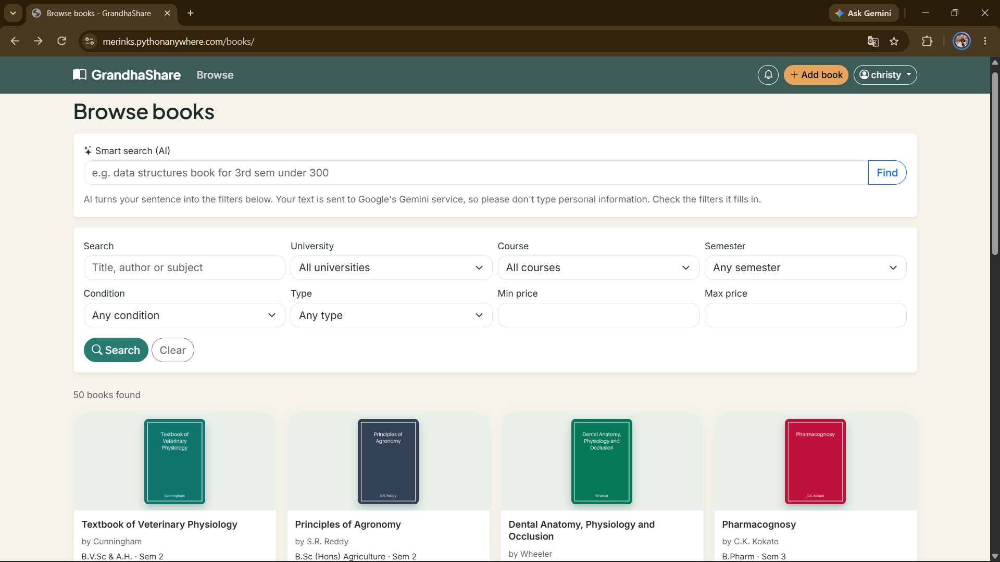
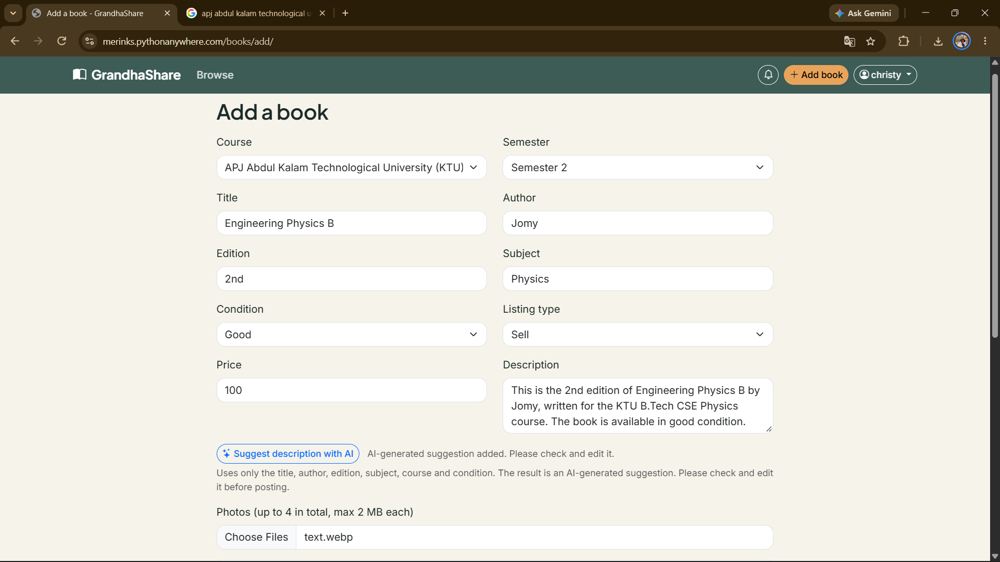
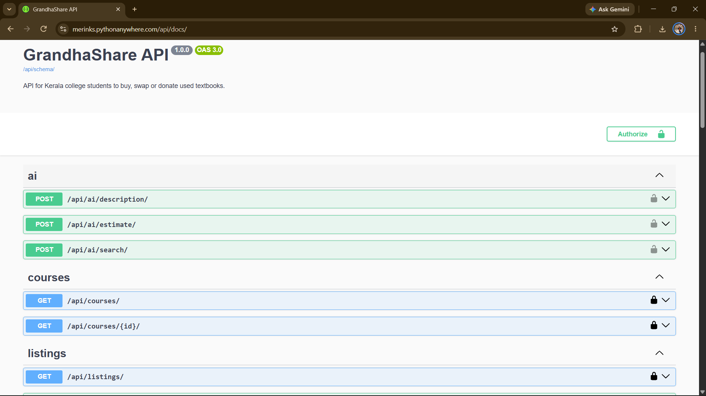

# GrandhaShare

**Buy, swap or donate used textbooks, organised by Kerala university, course and semester.**

**Live demo:** https://merinks.pythonanywhere.com  


> The live site contains **demo data** (labelled "Demo" on each book). It has no real users yet.

## The problem

Textbooks are expensive and often used for only one semester. General marketplaces like OLX or Quikr are not organised around Kerala syllabi. GrandhaShare lets students find books by **university, course and semester** (KTU, MG, Calicut, Kerala, Kannur, CUSAT, KUHS, KAU, KUFOS, KVASU, NUALS). There is no payment or delivery: students meet on campus.

## Features

- **Listings:** add, edit and delete books with up to 4 photos; sell, swap or donate
- **Discovery:** keyword search with filters (university, course, semester, condition, type, price), pagination
- **Request flow:** a buyer sends a request, the seller accepts or rejects it, and **contact details appear only after acceptance**; mark completed and reopen
- **Accounts:** signup with profile, login, **email verification** (needed to post or request), **forgot password**
- **Email notifications** for new, accepted and rejected requests
- **Safety:** report a listing; admin panel with report counts and filters
- **REST API** with JWT login and Swagger docs (see below)
- **AI features** (see below)

| Browse | Book detail |
|---|---|
|  |  |

## AI features (Google Gemini)

All three are **suggestions the user can change**. The server calls the AI, so the API key never reaches the browser.

1. **Description writer:** drafts a short description from the book's title, author, subject and condition. The prompt tells the model not to invent facts.
2. **Condition check:** looks at the uploaded photos and suggests a condition and visible problems. The **price range is not from the AI**: it is a simple rule of thumb (a percentage of the original price the seller enters), labelled as not market data.
3. **Smart search:** turns a sentence like "data structures book for 3rd sem under 300" into the normal search filters. The AI only fills filters, so it cannot invent books, and every value is validated (IDs must exist, semester 1 to 8, and so on).



AI calls are login-required, rate-limited, and fail gracefully: if the AI service is busy, the page shows a friendly message and the normal features keep working.

## REST API

Interactive docs at `/api/docs/` (Swagger, generated by drf-spectacular).

| Endpoint | Purpose |
|---|---|
| `POST /api/token/`, `/api/token/refresh/` | JWT login (30-minute access token) |
| `/api/listings/` | List, search, filter, create, edit, delete (owner only) |
| `/api/universities/`, `/api/courses/` | Read-only reference data |
| `/api/requests/` | Send and view requests; `accept` and `reject` actions for the seller |
| `/api/ai/description/`, `/api/ai/estimate/`, `/api/ai/search/` | AI features |



## Design and security decisions

- **Ownership checks:** only the seller can edit or delete a listing or answer its requests (other users get 403 or 404)
- **Privacy:** contact details are shown only to the buyer and seller after acceptance, and hidden again if the seller reopens the book; the API follows the same rule
- **Server-side rules:** the client cannot set `seller` or `status`; the server sets them
- **Data integrity:** database constraints prevent duplicate requests and duplicate reports; accepting a request uses `transaction.atomic()` and `select_for_update()` so the request and the listing change together
- **Emails after commit:** notifications are sent with `transaction.on_commit`, and an email failure never breaks the request flow
- **Rate limiting** on the API, with a stricter limit on login and on AI endpoints
- **Secrets** are in environment variables, never in the repository; debug is off by default
- **Email verification** uses signed, 24-hour links and is enforced in both the website and the API

## Tech stack

Python, Django 6.1, Django REST Framework, SimpleJWT, django-filter, drf-spectacular, SQLite, HTML, CSS, Bootstrap 5, Bootstrap Icons, JavaScript, Pillow, Google Gemini API, Gmail SMTP, GitHub Actions, PythonAnywhere.

## Tests and CI

Automated tests (**REPLACE: number from `python manage.py test`**) cover ownership, request privacy, validation, email notifications, password reset, email verification and the AI endpoints. The AI tests use **mocks**, so they use no network and no API quota. GitHub Actions runs the tests on every push.

```
python manage.py test
```

## Run it locally (Windows PowerShell)

```powershell
git clone https://github.com/merinks2004/grandhashare.git
cd grandhashare
python -m venv venv
venv\Scripts\activate
pip install -r requirements.txt
copy .env.example .env
```

Edit `.env` (set `DEBUG=True`; the other values are optional for local use: without email settings, emails print in the terminal, and without a Gemini key the AI buttons show "unavailable"). Then:

```powershell
python manage.py migrate
python manage.py seed_data
python manage.py seed_demo
python manage.py createsuperuser
python manage.py runserver
```

`seed_demo --clear` removes the demo books and demo sellers.

## Environment variables

See `.env.example`. Main ones: `SECRET_KEY`, `DEBUG`, `ALLOWED_HOSTS`, `CSRF_TRUSTED_ORIGINS`, `SITE_URL`, `GEMINI_API_KEY`, `GEMINI_MODEL`, `SMTP_USER`, `SMTP_PASSWORD`, `DEFAULT_FROM_EMAIL`.

## Honest limitations

- **Demo data only.** No real users yet; a pilot with students is planned.
- **Email verification proves a working email address, not that someone is a student.**
- Free hosting (PythonAnywhere) must be renewed monthly, and the database is SQLite.
- Email is sent through a Gmail account, which has daily sending limits.
- AI depends on Google's Gemini service, which can be briefly busy. On the free tier, Google may use submitted content to improve its products, so only book details and book photos are sent, never contact details. The Gemini terms also say services aimed at people under 18 are not allowed, and some first-year students may be 17.
- The condition check sees photos only, so it cannot judge the inside of a book. Its price range is a rule of thumb.
- Known small issues: the "Min price" filter hides donated books; image files stay on disk when a listing is deleted; the website photo upload relies on the browser's file type (the AI photo endpoint checks images properly); semesters 1 to 8 do not fit MBBS or BDS; course names were written from memory and need checking against official sites; a profile can store a course that does not belong to its university.

## What I would build next

Real-time chat, wishlist and alerts, college-email verification, PostgreSQL, Docker and image storage on S3, and a pilot with 10 to 20 real students.

## Credits

Demo book covers are generated with Pillow (no publisher cover images). Icons: Bootstrap Icons. Fonts: Plus Jakarta Sans and Inter (Google Fonts).

## Author

**Merin K S**, Python Full-Stack with AI fresher, Kerala  
GitHub: https://github.com/merinks2004 · LinkedIn: **REPLACE with your LinkedIn link** · Email: **REPLACE with your email**